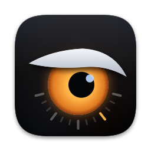

<p align="center">
  
</p>

<h1 align="center">hawk</h1>

<p align="center">
  A light, fast toolkit for keeping an eye on your Mac.<br>
  System monitor, fan control, battery and energy, network by process, storage cleanup.
</p>

---

Activity Monitor answers "what is busy". Hawk answers the next questions: what
is draining the battery and how much time quitting it would give back, why the
fans are running, which caches are safe to clear and what clearing them costs,
and which app is using the network. It does that while costing under 5% of one
core and about 60 MB, and shows its own cost in the header so you can check.

> Early and moving fast. The Android and Security tabs are starting points.

## What it does

| Tab | What you get |
|---|---|
| **Overview** | CPU per core (efficiency and performance), GPU, temperatures (chip, GPU, SSD, battery), memory and swap, disk I/O, network, power and charging. Fan gauges and control. |
| **CPU / Memory** | Every process with real power in watts, CPU time, wake-ups, disk; memory with growth over the last minute and peak. Search, sort, quit. |
| **Energy** | Energy per app over 10 minutes, an hour or since unplugging, its share of the whole Mac, and the battery time quitting it would give back. What the charger is doing. |
| **Network** | Download and upload per process. |
| **Storage** | Where the disk goes, what grew, what is safe to clear and what each deletion costs to get back. Simulators, DerivedData by project, Docker volumes and who uses them, WhatsApp media per chat (measured only, never deleted). |
| **Android** | Every device adb sees (USB, Wi-Fi, emulators) with its model, Android version and battery. The start of a full adb toolkit. |
| **Security** | Light checks: startup items (and an alert when a new one appears, even with the window closed), programs running from odd places, other programs holding your SSH key, keychain or browser cookies open. A deep scan of every running program's signature, on demand. |

Plus **alerts** (low disk, memory pressure, swap growth, leaking processes, hot
chip or battery, an app draining the battery, a new startup item) in the app and
as notifications.

Hawk lives in the **menu bar**: the icon (with the chip temperature next to it
if you like) opens a panel with the essentials, fan mode and recent alerts.
Closing the window keeps Hawk running there, at a fraction of the cost.

## Install

Needs macOS 26 on Apple Silicon and the Swift 6.2 toolchain (Xcode 26).

```sh
git clone git@github.com:marcosfons/hawk.git
cd hawk
make install        # ~/Applications/Hawk.app and the hawk CLI in ~/.local/bin
```

Optional, once, with admin rights:

```sh
make && sudo make install-helper
```

The helper is a small root daemon. It is needed to set fan speeds and to show
CPU, memory and energy for system processes. It accepts only admin users, clamps
every speed to what the fans support, and gives the fans back to macOS when Hawk
quits, goes quiet for 5 seconds, or the chip reaches 90 °C.
`sudo make uninstall-helper` removes it.

For the Storage tab, give Hawk **Full Disk Access** (System Settings > Privacy &
Security). Without it macOS hides other apps' data and the Trash.

## Storage

The Storage tab reads a scan of a storage registry: a JSON catalog of the
places worth watching, with what each one is, what deleting it costs and how to
reclaim it, measured by a separate scanner into `scans/latest.json`. Point Hawk
at the folder that holds it:

```sh
defaults write com.marcos.Hawk storageFolder ~/path/to/storage
```

Simulators, DerivedData, Docker volumes and WhatsApp media are read live.

## Fans

- **Auto** leaves them to macOS, which keeps them off while the Mac is cool.
- **Curve** spins them up only when the chip, SSD or battery passes its start
  temperature, ramping smoothly. On battery it hands control back to macOS by
  default, since the fans cost power.
- **Fixed** holds one speed.

## Command line

```sh
hawk                      # live dashboard in the terminal
hawk log > run.csv        # one CSV row per second: load, temperatures, fans, watts
hawk dump T               # every SMC temperature key
sudo hawk set 4000 --for 60   # hold a speed for a minute, then back to macOS
```

## When something goes wrong

```sh
make problems     # warnings and errors, kept in ~/Library/Logs/Hawk/hawk.log
make log-live     # everything as it happens, with timings of each step
```

Every slow step (a sensor read, a table update, a stalled main thread) is
logged as `Slow: ...` with how long it took.

## Development

```sh
make check        # build with warnings as errors, then the unit tests
make run          # build and open the app
make icon         # redraw the icon (tools/make-icon.swift)
```

`CLAUDE.md` holds the conventions: the performance budget and how it was met,
the safety rules, and the code style.

## License

MIT. See [LICENSE](LICENSE).
